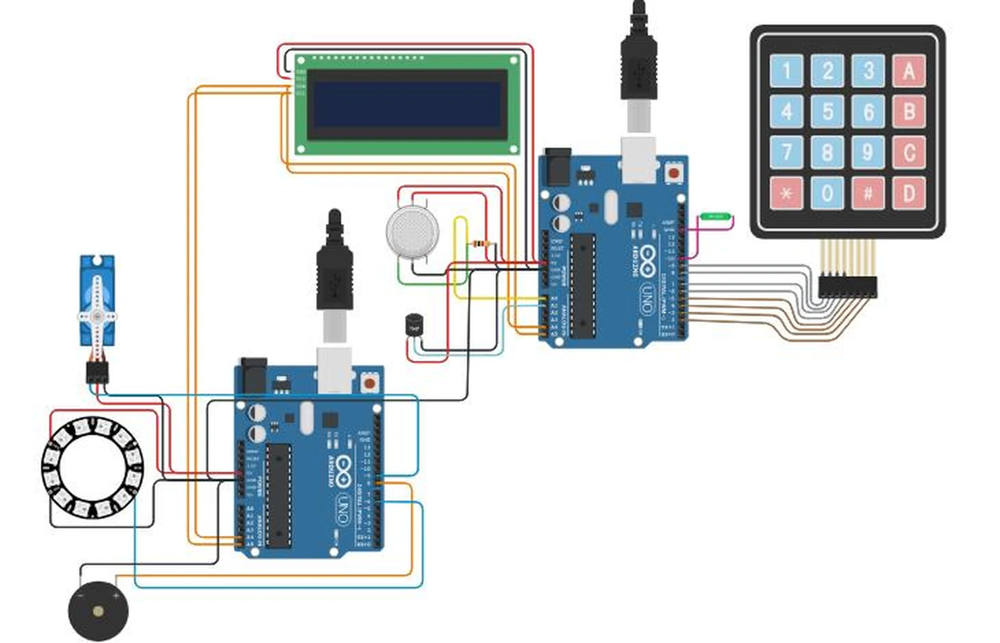
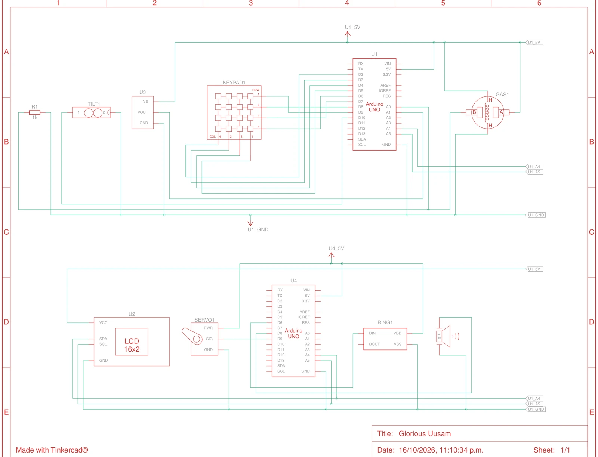

# Alerta sísmica con Arduino

Sistema de alerta ante **sismo, incendio y fuga de gas**, diseñado y simulado en Tinkercad Circuits
(diseño «Glorious Uusam»). Usa dos Arduino Uno comunicados por I2C.

## Cómo funciona

| Arduino | Programa | Función |
| --- | --- | --- |
| U1 · controlador (maestro I2C) | [`controlador/controlador.ino`](controlador/controlador.ino) | Lee cada 500 ms el sensor de inclinación (pin 10), el de gas (A0) y el de temperatura TMP36 (A1). Muestra los valores en un LCD 16×2 I2C y envía el código de alerta al otro Arduino. Con un teclado 4×4 se introduce la clave para desactivar la alarma (`*` borra, `#` confirma). |
| U4 · actuadores (esclavo I2C, dirección 8) | [`actuadores/actuadores.ino`](actuadores/actuadores.ino) | Recibe el código de alerta. Abre la puerta de emergencia con un servo (pin 9), anima un anillo NeoPixel de 12 LED (pin 6) y hace sonar el zumbador (pin 8) con un patrón distinto para cada evento. |

Códigos de alerta: `0` normal, `1` sismo (máxima prioridad, luz naranja), `2` incendio (temperatura > 50 °C, luz roja) y `3` fuga de gas (lectura > 300, luz morada).
Una vez activada, la alerta se mantiene hasta que se introduce la clave correcta.

> La clave `1234` es un valor de demostración para la simulación.

## Esquema

## Componentes

2 × Arduino Uno R3, LCD 16×2 (I2C), teclado de membrana 4×4, sensor de gas con resistencia de 1 kΩ,
sensor de temperatura TMP36, sensor de inclinación SW-200D, micro servo, anillo NeoPixel de 12 LED y zumbador piezoeléctrico.

## Bibliotecas

`Wire`, `Keypad`, `Adafruit_LiquidCrystal`, `Servo` y `Adafruit_NeoPixel` (todas disponibles en Tinkercad).
